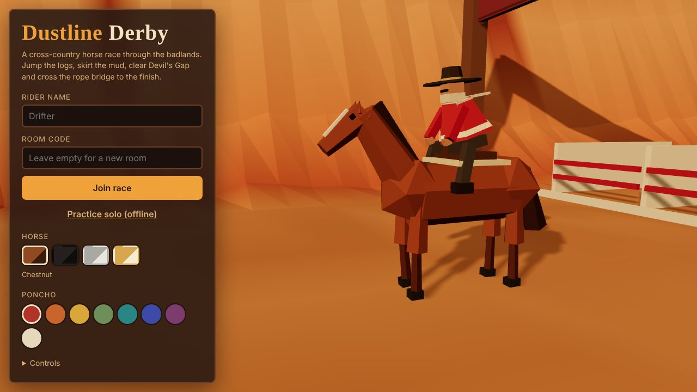
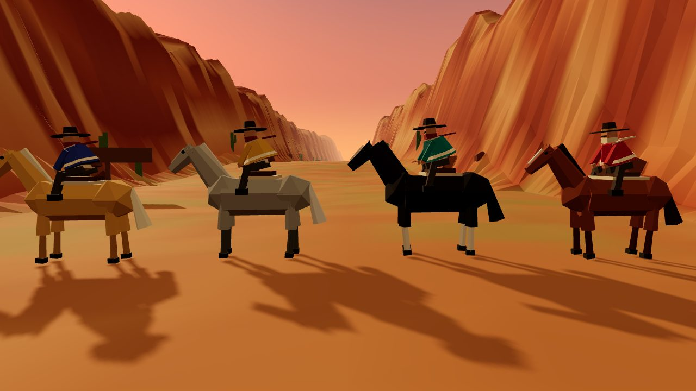
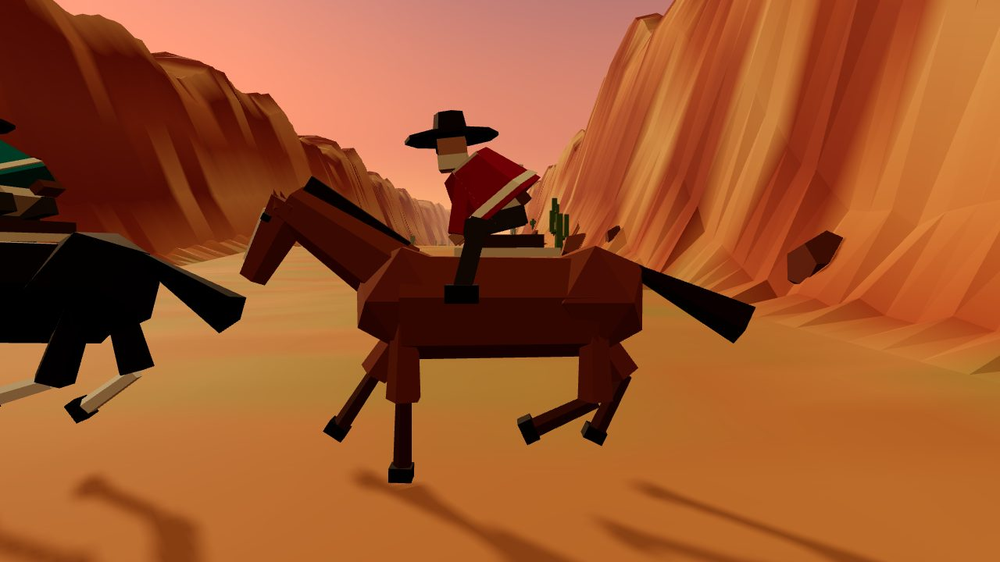
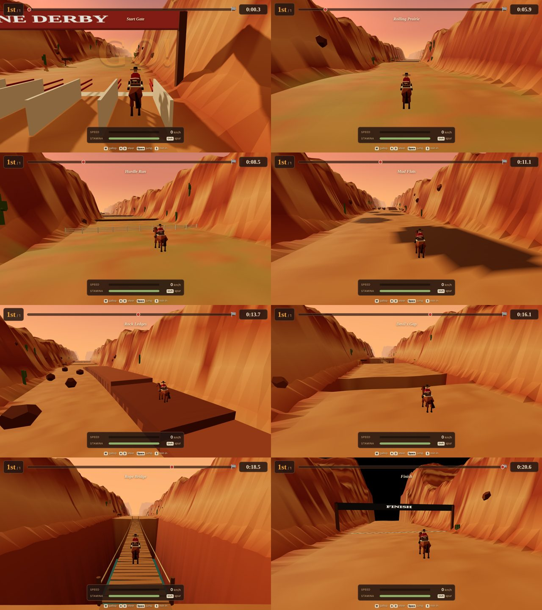

# Dustline Derby: rough design

An online, cross-country horse race through a red-rock canyon. Up to 8 riders start from the stalls at the same moment, then race over a 1.2 km course with obstacles to clear. The first rider over the finish line wins.

Everything here is original: the name, riders, horses and course. The only idea borrowed from long-distance race stories is "a horse race across wild country".

## Art direction

- **Low-poly, flat-shaded.** Every model is built from a few three.js primitives (boxes, cylinders, cones). There are no textures except text on signs and the checkered finish line.
- **Sunset badlands palette.** Ochre dust, rust and sandstone canyon walls in horizontal bands, sage cacti, and a warm low sun ahead of the riders, so shadows fall back toward the camera.
- **Readable at a gallop.** Obstacles span the full track width and contrast with the ground: white fences, dark logs, near-black mud.

## The rider: "the Drifter"

A lean frontier courier. Every player rides as the Drifter and picks a **poncho colour** (8 options) so friends can tell each other apart.

| Part | Shape |
|---|---|
| Wide-brim hat | Thin cylinder brim plus tapered crown, with a gold band |
| Face | Skin-tone box, bandana pulled up over the lower half, shadow across the eyes |
| Poncho | Six-sided flared cone in the player's colour, with a cream stripe |
| Arms | Reach forward to the reins |
| Satchel | Leather box on the back hip, for the courier role |
| Legs | Dark trousers, boots in the stirrups |
| Scarf | A strip from the bandana that flutters behind at speed |

Animation: the rider sits upright at rest. At a gallop they lean into a two-point position and absorb the horse's bounce. On a stumble they pitch forward and wobble.

## The horses

All horses share one body plan: barrel torso, chest and rump, angled neck, wedge head with ears, eyes and a blaze, two-part legs with hooves, mane strip and flared tail, plus saddle blanket and saddle. There are four coats:

| Coat | Body | Mane / tail | Lower legs |
|---|---|---|---|
| Chestnut | Red-brown | Dark brown | Brown |
| Black | Near-black | Black | White socks |
| Dapple Grey | Grey | Off-white | Dark grey |
| Palomino | Gold | Cream | Darker gold |

The coats are only cosmetic. Every horse has the same stats in this version.

Gallop: a procedural four-beat cycle. Each leg swings at its own phase offset (hind-left, hind-right, fore-left, fore-right) and knees and hocks fold on the swing. The body bobs and pitches, the neck pumps, and the tail lifts with speed. In the air all four legs tuck. A stumble drops the nose and shakes the body.

## The course ("parkour")

The course runs along a winding canyon corridor 28 m wide. The canyon walls keep riders on track. Sections in order:

| # | Section | Distance | What you do |
|---|---|---|---|
| 1 | **Start Gate** | 0 m | 8 stalls. The gates swing open on "GO!" |
| 2 | **Rolling Prairie** | 40–260 m | Three long hills. Settle into a gallop and save stamina |
| 3 | **Hurdle Run** | 260–440 m | 3 logs (0.8 m) and 2 post-and-rail fences (1.0 m) across the full width. Jump or stumble |
| 4 | **Mud Flats** | 440–580 m | Dark mud patches halve your top speed. Steer through the gaps |
| 5 | **Rock Ledges** | 580–715 m | Left: a stepped mesa (1 m, 2 m, 3 m) to jump up and ride along. Right: a boulder field to weave through |
| 6 | **Devil's Gap** | 745–755 m | A 10 m ravine across the whole canyon. Jump from full gallop. Fall in and you restart at the last checkpoint |
| 7 | **Rope Bridge** | 800–870 m | A 3.6 m wide sagging plank bridge over a river chasm. Steer straight or fall |
| 8 | **Long Descent** | 885–1140 m | A 14 m downhill run. Spur hard |
| 9 | **Finish** | 1160 m | Arch, banner and checkered line |

Checkpoints (yellow flags) sit at 260, 440, 575, 712, 785, 885 and 1000 m. A fall puts you back at the last one you passed. A bot rider clears the whole course in about 71 s.

## Controls and movement

| Key | Action |
|---|---|
| `W` / `↑` | Gallop (accelerate to 61 km/h) |
| `Shift` | Spur: sprint up to 86 km/h while stamina lasts |
| `A` `D` / `←` `→` | Steer (less agile at full speed, barely at all in the air) |
| `Space` | Jump (about 1.5 m high, 12–18 m long depending on speed) |
| `S` / `↓` | Rein in |

- **Stamina:** draining it at a sprint takes about 4 s, and it refills in about 8 s.
- **Stumble:** hitting an obstacle at speed costs 70% of your speed and 0.7 s of control.
- **Small steps:** steps up to 0.45 m are taken in stride. Anything taller needs a jump.

## Multiplayer

- Rooms have 4-letter codes and hold up to 8 riders. Share the invite link (`?room=ABCD`).
- The race starts when every rider is ready, or when the host presses **Start now**. The server sends a 3.5 s countdown.
- Each client simulates its own horse and sends its position 20 times a second. Other horses are drawn about 110 ms in the past, smoothly interpolated.
- The server records finishing order and times. Riders still out 45 s after the first finisher get a DNF.
- Players who join during a race spectate the leader and ride in the next race.

**Known limits (v1):** movement is client-authoritative, so this is for friendly races, not ranked play. The server only checks that a finish claim comes from near the line. Riders pass through each other.

## Ideas for later

- Horse stats per coat (speed vs. stamina vs. jump)
- Rider-to-rider bumping and drafting
- More courses, and a course picker in the lobby
- Touch / gamepad controls
- Server-side validation of movement
