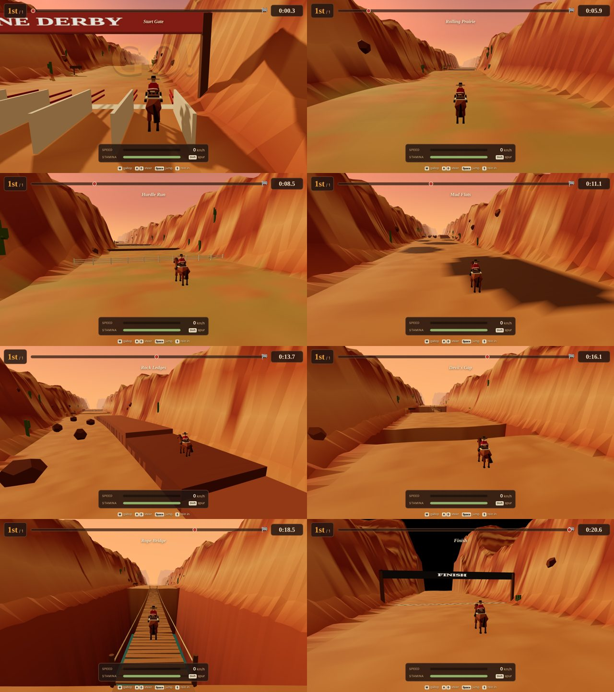

# Dustline Derby

An online 3D horse race through a red-rock canyon, built with Vite, three.js and a small WebSocket server. Up to 8 riders race from the start gate over hurdles, mud, rock ledges, a ravine and a rope bridge to the finish line.

See [DESIGN.md](DESIGN.md) for the rider, horse and course designs.



## Run locally

```bash
npm install
npm run dev
```

Open [http://localhost:5173](http://localhost:5173). The dev server also hosts the race rooms, so other people on your network can join at `http://<your-ip>:5173`.

## Controls

`W` gallop · `A`/`D` steer · `Space` jump · `Shift` spur (sprint) · `S` rein in. Arrow keys work too.

## Play online with friends

1. One person creates a room (leave the room code empty) and clicks **Copy invite link**.
2. Friends open the link, or type the 4-letter code.
3. Everyone clicks **I'm ready**, or the host clicks **Start now**.

For friends outside your network, the server has to be reachable from the internet. Either:

- **Deploy it** to any Node host (Render, Railway, Fly.io, a VPS): build command `npm install && npm run build`, start command `npm start`. It listens on `PORT` (default 3000) and serves both the game and the `/ws` rooms.
- **Tunnel a local server**: run `npm run build && npm start`, then expose port 3000 with a tunnel such as `cloudflared tunnel --url http://localhost:3000` or `ngrok http 3000` and share the URL.

**Practice solo (offline)** works without a server. Your best time is saved in your browser.

## Build

```bash
npm run build     # outputs to dist/
npm start         # serves dist/ and the race rooms on port 3000
```

## Debug

Add `?debug` to the URL. Keys `1`–`8` teleport you to the start and each checkpoint, and `9` puts you just before the finish.
